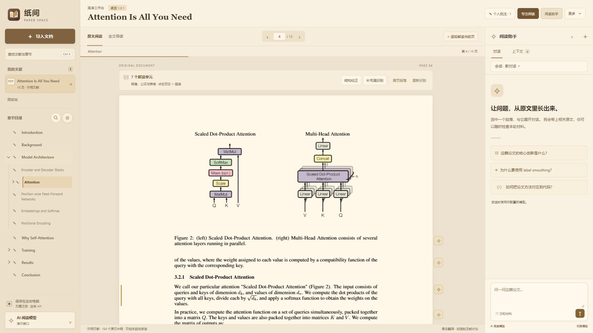

<p align="center"></p>

# 纸间 · Paper Space

[English](README.en.md) · 简体中文

**让问题，从原文里长出来。**

本机优先的 AI 论文阅读工作台。保留 PDF 原貌，把翻译、段落解读、章节批注和带来源的对话放在同一个阅读空间里。无需注册，AI 使用你自己的接口。

[](https://github.com/martin2026US-lab/paper-space/actions/workflows/test.yml)




▶ **[在线观看 58 秒 AI 功能宣传片](https://martin2026US-lab.github.io/paper-space/)** · [下载视频（MP4）](https://github.com/martin2026US-lab/paper-space/releases/download/v1.0.2/paper-space-ai-demo.mp4)

## 1.3.1 经典风格调整

经典风格的常用按钮、目录和设置采用随应用提供的开源衬线字体，字号提高至约 14–16px。「更多」菜单统一条目样式，修复新增条目出现按钮边框的问题；小屏下菜单按可用高度滚动，工具栏自动换行。杂志风格、PDF 原貌及现有资料和模型配置保留。

## 1.3.0 翻译质量与识别体验

- **本机基础质检**：检查数字、引用、单位和术语；按需展开提示，不将启发式检查当作准确率评分。
- **独立 AI 复核**：沿用阅读 AI 或自配 OpenAI / Anthropic 兼容接口。只在点击时发送当前原文与译文，建议经确认后采用，可撤销；原文与历史译文保留。
- **术语表**：导入/导出 CSV、TSV、JSON，按目标语言匹配。AI 翻译使用相关术语约束；专用翻译 API 输出做一致性检查，不做生硬替换。变更术语后使用独立缓存。
- **文档识别**：快速/精细模式、真实阶段与耗时、排队、取消、重试及错误详情；支持自配 Docling Serve v1 与服务端 OCR，远程仅手动开始才上传 PDF。
- **升级兼容**：完整备份包括术语、识别与复核元数据、修订历史；密钥仍使用本机加密或会话存储，保持经典/杂志风格和原有模型配置。

[翻译质量与识别接口说明](docs/QUALITY-RECOGNITION.md)

## 1.2.2 阅读尺寸与配色修复

杂志风格改为暖白纸面、石墨色文字与少量灰绿选中标记，统一 PDF、Word、助手及设置窗口。PDF 默认适合当前阅读区宽度，可选择整页或百分比缩放；原文件与文字层保持对应。左侧通过固定的「文献库 / 阅读目录」按钮切换，结构识别工具收在可展开的辅助栏中。经典风格、现有文献、批注及模型配置保留。

## 1.2.1 杂志阅读

右上角可在「经典 / 杂志」间切换，原有安装默认保留经典风格。杂志风格采用本机衬线字体，窄目录搭配单栏正文；小屏打开阅读助手时，目录收成工具栏，按需展开文献和章节。翻页与批注放在底部，双语页顶部可直接选择目标语言、翻译本页或停止。

两种风格共用现有文献、原文件、批注、会话及模型配置，分别记住布局。切换保留当前页、阅读位置和问题草稿，不自动发送内容。

## 1.2.0 新增

- **段落双语阅读**：阅读区切换「双语阅读」，原文在上、译文在下。可逐段翻译或翻译当前页，支持收起、取消与缓存复用；进入视图不会自动调用接口。
- **完整备份与恢复**：「更多 → 备份与恢复」导出压缩的 .paperbackup 文件，包含原文件字节、文献库（含回收站）、批注、完整会话、引用、译文缓存和接口元数据。校验成功并确认后才恢复，重复文献创建副本，保留现有资料。API 密钥与模型权重不包含在可携带备份中。
- **轻量安装与独立组件**：安装包不再携带 Python、Docling 与识别模型；通过「更多 → 文档识别组件」从官方源一键下载配置，或接入已有环境。组件目录独立于程序，后续更新不重复下载。升级会优先保留旧版识别环境。

## 1.1.0 新增

- **中英文界面**：首次使用说明页可直接选择 English；也可在「更多 → 语言与翻译 → 界面语言」切换。选择保存在本机，切换时保留阅读位置和未发送问题。
- **三种语言各自设置**：界面语言、翻译目标语言、解读与回答语言互不覆盖；原文、已有笔记、对话和自定义名称保持原样。
- **独立翻译与本机模型切换**：翻译可使用本机模型、自定义 AI 接口或专用翻译 API。同一个本机地址下可从列表切换已安装模型。
- **阅读体验**：整段翻译、开源衬线字体、简化主页与玻璃边框，修复“更多”菜单遮挡。

## 可以做什么

- **原文先出现**：PDF 保留页面与文字层，版面识别在本机后台进行；支持 DOCX、TXT、Markdown。
- **围绕原文用 AI**：单击句子或一键整段翻译，逐段解读，选区讨论，全文导读；对话前可查看与排除本轮材料，回答中的来源可回到原文。
- **章节式阅读**：分层目录、圆形章节转盘、快速查找、专注阅读；支持跨页段落、手动结构校正与疑似漏段提示。
- **留下自己的理解**：个人批注与章节对应，按文献保存多个独立对话，导出 Markdown 阅读笔记。
- **语言与翻译**：原文自动识别。在「更多 → 语言与翻译」分别选择翻译目标、解读与回答语言，支持 12 种常用语言。翻译可独立使用本机模型、自定义 AI 接口或用户接入的翻译接口；服务语言自动映射，不支持的目标不可选。
- **专注阅读**：围绕原文、批注和阅读对话展开，不再提供额外代码文件导入或代码材料检索。
- **自配 AI 接口**：不内置对话大模型、不提供 API Key；支持 OpenAI 兼容 Chat Completions、Anthropic Messages 和兼容的本机模型接口。
- **暖纸色界面**：让阅读、翻译和旁注同时可见，减少窗口切换。

## 下载安装（推荐）

**[下载 Windows 安装包](https://github.com/martin2026US-lab/paper-space/releases/latest)** · [安装与升级说明](docs/INSTALL.md)

面向 Windows 10 / 11 x64。下载 Setup.exe 即可安装阅读器；PDF 原版、Word 和文本阅读无需配置 Node.js、Python 或识别模型。需要文档结构识别时，在应用中一键配置可选 Docling 组件。个人资料保存在用户目录，升级与卸载保留。AI 功能使用你自己的模型接口。

### 独立翻译服务

在「更多 → 语言与翻译 → 设置翻译服务」选择翻译方式。翻译目标只作用于单句和整段翻译；「解读与回答语言」用于旁注、导读和问答，阅读 AI 仍在左下角选择。

- **本机模型**：填写本机地址，从自动读取的已安装模型列表选择；可刷新列表或手动填写 ID，选择后保存生效。首次配置仅检测本机模型列表，未检测到时沿用阅读 AI。
- **沿用阅读 AI**：使用左下角当前模型，翻译目标语言独立选择。
- **自定义 AI 接口**：自行填写地址、模型和密钥，支持 OpenAI 兼容、Anthropic 协议。
- **自定义翻译接口**：自行填写地址、密钥及接口要求的区域；按接口文档选择 LibreTranslate、DeepL 或 Translator v3 兼容协议。这里的协议决定请求格式，不指定服务商，也不预填云端服务地址。接口需实现所选兼容协议，目标语言通过接口语言列表检测并映射。

专用翻译服务保存前检测可用目标语言，发送原文并使用服务商语言代码，省略源语言以自动识别。切换目标或服务不会自动翻译，也不会在失败后改用其它接口。浏览器密钥只保存在会话中；桌面版可用 Windows 系统加密保存，翻译密钥与阅读 AI 密钥分别绑定。

## 从源码运行（开发者）

需要 **Node.js 22+**。浏览器版不需要安装 npm 依赖，前端库已随源码附带。

```sh
git clone https://github.com/martin2026US-lab/paper-space.git
cd paper-space
npm start
```

打开 **http://127.0.0.1:4317**，导入自己的文档。可选：启动前运行 `npm run setup:demo` 下载公开的 *Attention Is All You Need* 示例。已经初始化的文献库可以直接导入下载后的 `public/demo.pdf`。

### Windows 桌面版（源码启动）

```sh
npm ci
npm run desktop
```

桌面版监听 `127.0.0.1:4319`，数据保存在项目的 `data/`。F12 打开开发者工具。源码方式的 Electron 首次安装需要联网；普通用户请使用上方安装包。主要验证平台为 Windows。

### 可选：本机 PDF 结构识别

Windows 桌面版可直接在「更多 → 文档识别组件」选择保存目录，再点击「一键下载并配置」。使用官方 Docling/PyPI、PyTorch CPU 与 Hugging Face 模型源；工具来自 uv 官方仓库并核验 SHA-256。Python、下载缓存和模型保存在所选组件目录，安装失败或取消不会替换正在使用的环境。首次配置需要联网，之后解析保持离线。


未配置 Docling 时，仍可显示 PDF 原文和提取可选文字；逐段语义解读需要成功完成结构识别。扫描件 OCR 暂未启用。

使用 **Python 3.12** 创建独立环境（以下为 Windows PowerShell；需预留模型及依赖所需磁盘空间）：

```powershell
py -3.12 -m venv runtime/venv
./runtime/venv/Scripts/python.exe -m pip install -r python/requirements.txt
./runtime/venv/Scripts/python.exe python/download_models.py
$env:PAPER_SPACE_PYTHON = (Resolve-Path './runtime/venv/Scripts/python.exe').Path
npm start
# 或 npm run desktop
```

每次启动需要设置 `PAPER_SPACE_PYTHON`，或者将它配置为用户环境变量。模型下载是显式的一次性联网操作；解析文档时禁用远程服务与模型自动下载，使用 CPU。`PAPER_SPACE_RUNTIME` 可覆盖运行环境目录，`PAPER_SPACE_PDF_DATA` 可覆盖浏览器版解析缓存目录。Windows 一键配置已在独立新环境完成真实下载与离线解析验证；网络下载失败时仍可阅读原文。

## 首次使用说明

首次启动需主动勾选确认「使用声明与隐私说明」，未确认前不加载文献库、不进行文档识别，也不能使用工作台。确认记录仅保存于本机；说明版本变化后需重新确认。可通过「更多 → 使用声明与隐私」重看。

请确保资料来源及预期使用方式符合版权、许可与保密要求，向 API 发送内容前核对相应授权。所配置 API、访问方式与使用行为须符合所在地适用法律法规及服务商条款。AI 输出需要自行核对，确认说明不免除法律规定不得免除的责任。

## 数据与 API

纸间不内置对话大模型、不预置 API Key，也不默认连接 AI 服务。可选 Docling 模型仅在本机识别文档结构，首次安装从官方源下载。识别文档时不启用远程服务。

文献、笔记和对话留在本机。应用仅监听回环地址，导入文件不会上传。点击翻译、生成解读、导读或发送对话时，才向你配置的模型接口发送相应材料；全文导读会使用全文。设置中的连接测试与模型检测也会访问所配置接口。

浏览器版密钥仅保留在当前页面内存；桌面版可使用 Electron safeStorage / Windows DPAPI 加密记住密钥。服务端不记录密钥、原文或回答。模型供应商仍按其自身条款处理收到的内容。

`data/`、`runtime/`、密钥文件、解析缓存及本机测试数据已加入 `.gitignore`。**不要把这些目录提交到自己的分支，也不要在 Issue 中贴出 API Key 或私人论文。** 导出笔记不是完整资料备份；清除浏览器网站数据会移除其本机文献库。

## 快捷键

| 操作 | 快捷键 |
| --- | --- |
| 查找文献与章节 | Ctrl K |
| 专注阅读 | Ctrl Shift F |
| 上一页 / 下一页 | Alt ← / → |
| 收起转盘或弹层 | Esc |

## 开发与测试

```sh
npm test
```

Node 测试使用合成材料与本机模拟模型，不需要真实 API Key。入口为 `server.mjs`，桌面入口为 `desktop/main.mjs`，前端在 `public/`，离线解析脚本在 `python/`。

`tests/*-browser-server.mjs` 是人工运行的浏览器回归环境，使用独立端口和 `.test-data/`。涉及公开论文的历史浏览器用例还需 `public/demo.pdf`、本机 Docling，以及通过 `python/parse_pdf.py public/demo.pdf tests/sample-layout.json runtime/models` 生成的示例版面文件；这些下载/生成文件不会提交。详细说明见 [测试说明](tests/README.md)。

欢迎提交 Issue 与 Pull Request。复现问题请优先使用公开或合成文档，并说明系统、版本、文件类型及操作步骤。

## 当前边界

DOCX 使用语义阅读视图，阅读分页不是 Word 原始页码；复杂表格、公式及跨页关系仍需核对原文。上下文检索使用本机关键词，不是向量检索。AI 结果可能有误，请通过来源定位核对。尚未提供扫描件 OCR、云同步、图片提问或完整可恢复备份。

宣传片中的翻译与段落解读来自真实模型调用，等待时间经过剪辑；应用未接入模型时，示例解释会明确标记为预置演示。

## License

Paper Space is a local-first AI reading workspace for PDFs and documents, with sentence translation, grounded discussions, chapter notes, and offline layout analysis. Bring your own model endpoint. Run `npm start` with Node.js 22+, or `npm ci && npm run desktop` for the Electron app.

Original code is licensed under [MIT](LICENSE). Bundled libraries, optional model weights and example paper excerpts retain their own licenses. See [third-party notices](THIRD_PARTY_NOTICES.md).
